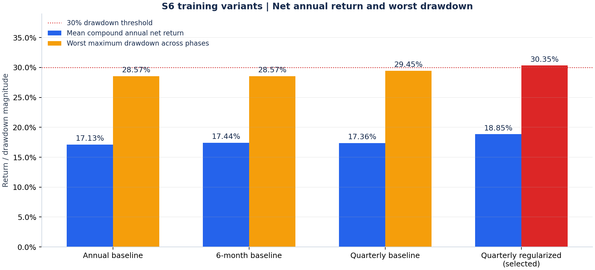

# A股多因子 LightGBM 研究与模拟交易

基于动态沪深300股票池的中低频横截面选股项目：从点时数据、成熟标签、多折验证，到账户式回测、过拟合诊断和富途模拟盘衔接。

**当前研究主版本：S6季度重训＋L1/L2增强＋低复杂度树。** 项目用于研究与工程实践，不是开箱即用的实盘交易系统，不构成投资建议。

[快速上手](docs/getting_started.md) · [当前策略报告](reports/current_strategy/README.md) · [指标口径](docs/results.md) · [架构导航](docs/architecture.md) · [数据与复现](docs/data_contract.md) · [模拟盘说明](paper_futu/S6_CURRENT_DEPLOYMENT.md)

这是从已脱敏文件建立的独立展示仓库，提交历史从本版本开始。未分发本机账户配置、模型与交易计划；模拟执行代码中的固定尾号 `0000` 是演示占位值。完整研究所需数据和运行条件见[数据契约](docs/data_contract.md)。

## 项目重点

- **信息时点一致**：T日收盘生成信号，标签使用下一交易日开盘至未来开盘的收益；只用成熟标签训练。
- **更新与调仓分离**：季度从零拟合模型，组合按5个交易日节奏调仓，跨年不重置。
- **账户可核对**：跟踪现金、持仓、费用和持仓数，不把预测标签直接当成策略收益。
- **结论有边界**：保留窗口、正则化、起点、摩擦和风格诊断；不把反复研究的历史称为独立测试。
- **部署有校验**：模拟账户限制、模型与计划哈希、季度有效期及持仓上限检查。

## 当前策略

| 项目 | S6季度联合约束版本 |
|---|---|
| 特征 | 12个价量＋3个基本面因子，原始数值输入 |
| 目标 | `Open(T+11) / Open(T+1) - 1` 的每日横截面排名减0.5 |
| 训练 | 2010年起扩展样本；按真实标签结束日期筛选；季度从零拟合 |
| 树数 | 执行年前三个年度验证折选定，执行年内固定，不随季度重新搜索 |
| 约束 | L1=1，L2=5，15个叶子，叶子最小样本数300 |
| 组合 | Top20；前6只占股票仓位40%，其余14只占60%；股票目标仓位95% |
| 调仓 | 每5个交易日，最多替换6只；保留股票也可能交易目标仓位差 |
| 回测 | 理想次日开盘成交；买入0.05%、卖出0.15%，每笔最低5元 |
| 模拟执行 | 09:31后限价单，**不保证按开盘价成交** |

公开参数见 [`configs/experiments/s6_head6_40_public.json`](configs/experiments/s6_head6_40_public.json)，它不包含本机路径、账户或交易切换安排，不能用于直接部署。`configs/main_strategy.yaml` 是旧年度Top50研究配置，不是当前S6部署配置。

## 当前策略研究结果

固定数据截止2026-10-13，连续账户2022-01-04至2026-10-13，从100万元现金开始，比较5个预设调仓起点。**当前选定季度联合约束版本的平均复合年化为18.85%，五起点最差回撤为30.35%。** 常提到的17%左右对应原年度或原季度版本，具体对照如下：

| 版本 | 平均复合年化 | 五起点最差最大回撤 | 平均累计费用 |
|---|---:|---:|---:|
| S6年度原版 | 17.13% | 28.57% | 19.92万元 |
| S6半年原版 | 17.44% | 28.57% | 20.33万元 |
| S6季度原版 | 17.36% | 29.45% | 20.19万元 |
| S6季度＋联合约束 | 18.85% | **30.35%** | 20.35万元 |

来源：[逐日净值汇总](reports/current_strategy/phase_daily.csv)、[逐起点指标](reports/current_strategy/phase_metrics.csv)及[原实验汇总](reports/experiments/s6_quarterly_l1l2_small_asof_20261013/summary.csv)。平均年化是五条账户各自复合年化的算术平均，不是累计收益除以年数；费用已计入净收益。

当前版本采用**固定年化无风险利率1%**计算夏普，五起点平均年化夏普为 **1.000**；相对沪深300的平均年化信息比率为 **1.503**。两者分别按各账户成本后日收益计算后取平均，公式见[主报告](reports/current_strategy/README.md)。

### 五起点净值与最大回撤

展示全部五个预设调仓起点，与同区间沪深300比较；每条曲线都是独立回放账户。回撤包含初始现金高点，红色虚线为原30%研究筛选线。


### 逐年收益

蓝色柱为五起点的平均成本后收益，误差线为最小至最大值；灰色柱为沪深300。2026只统计至10月13日。2024贡献较大，2025虽有正收益仍跑输基准。


### S6训练版本对照



**联合约束版本仍超过预设30%历史回撤线。** 它是用户选定的研究/模拟版本，不能称为通过全部风险筛选。银行风格暴露、多重试验选择偏差、理想成交和财报修订档案不完整仍是重要限制。2022—2026已反复参与研究，不是新的独立测试；详见[结果口径与局限](docs/results.md)。

完整的年度收益、逐起点指标、组合规则和结果来源见[当前策略报告](reports/current_strategy/README.md)。安装研究依赖后，可运行 `python -m scripts.build_current_strategy_report`，仅用仓库内汇总重建表格和图像。

## 快速体验

Python 3.11，在仓库根目录执行：

```powershell
python -m venv .venv
.venv\Scripts\Activate.ps1
python -m pip install -r requirements-demo.txt
python -m examples.offline_demo
```

离线示例使用固定种子的**合成行情**，演示特征、开盘标签、成熟边界、LightGBM训练及Rank IC，不下载数据、不连接券商、不写交易计划。示例只有简化特征，不是主策略收益复现。

完整研究环境与测试：

```powershell
python -m pip install -r requirements.txt
python -m pytest
```

`pytest.ini` 将发现范围限定在 `tests/`，避免遍历大型本地实验缓存。详细步骤见[快速上手](docs/getting_started.md)。

## 文档与代码

| 你想了解 | 从这里开始 |
|---|---|
| 数据、标签和复现前提 | [数据契约](docs/data_contract.md) |
| 训练、回测、部署分别在哪 | [架构导航](docs/architecture.md) |
| 当前收益、年度表现和图表 | [主策略报告](reports/current_strategy/README.md)与[指标说明](docs/results.md) |
| 窗口、正则化与风格依赖 | [四策略风险诊断](research_overfit_four_README.md) |
| 年度、半年、季度如何比较 | [重训频率实验](research_s6_2026_README.md) |
| 当前联合约束实验设计 | [季度正则化实验](research_s6_quarterly_regularized_README.md) |
| 项目讲解与面试准备 | [讲解提纲](docs/interview_guide.md) |
| 本机模拟盘运行条件 | [部署状态说明](paper_futu/S6_CURRENT_DEPLOYMENT.md) |

```text
configs/       研究配置及当前策略登记
src/           因子、标签、基础训练与历史研究入口
paper_futu/    账户回放、专项实验和模拟交易适配器
scripts/       研究审计、报告、资源调度工具
examples/      无外部数据的离线示例
tests/         时间边界、账户逻辑、调度与部署保护测试
docs/          使用指南、架构、数据契约和结果说明
reports/       选定公开汇总；大体积缓存留在本地
data/ models/  本地数据与模型，不随仓库分发
```

## 安全与复现范围

克隆仓库可以运行离线示例和测试，**不能直接恢复完整研究或模拟交易**。真实行情、财务快照、模型、完整成交记录、本机部署配置与策略登记均不随最新版分发。历史入口依赖已审计的父实验及数据哈希，缺失时应停止，不应跳过校验。

当前没有自动季度重训任务；新的服务季度需要重新训练并验证模型。模拟程序依赖本机Windows任务与已登录OpenD，不依赖Codex保持打开。请勿为运行示例而安装交易调度或绕过账户校验。

贡献与变更约定见 [CONTRIBUTING.md](CONTRIBUTING.md)，敏感信息处理见 [SECURITY.md](SECURITY.md)，新仓库的导出与检查范围见[发布审计](docs/publication_audit.md)。

## 参考项目

文档组织参考 [Microsoft Qlib](https://github.com/microsoft/qlib) 的数据、训练、回测工作流，以及 [Backtesting.py](https://github.com/kernc/backtesting.py) 的安装、最小示例与文档分层。本项目使用Qlib，不使用Backtesting.py作为回测引擎；未复制其策略代码或收益结果。第三方依赖遵循各自许可，本次整理不新增项目授权许可证。
