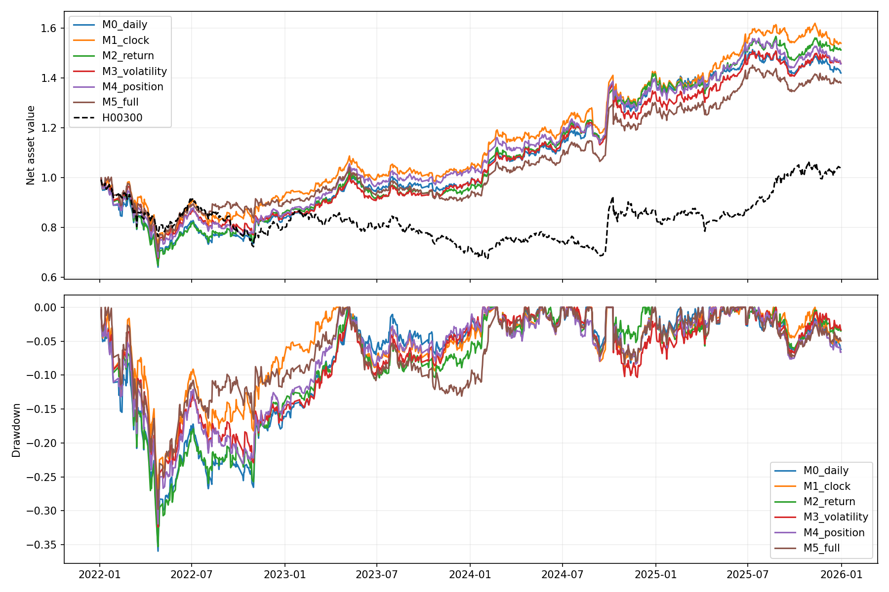

# A股多因子研究、风险归因与模拟交易

[](https://github.com/GreaterHunter/a-share-lightgbm-multifactor-clean/actions/workflows/tests.yml)

基于动态沪深300股票池的Python／LightGBM研究项目，覆盖数据核验、成熟标签、时间验证、季度重训、账户回测、风险归因与富途模拟执行。

[已有成果](docs/achievements.md) · [报告目录](reports/README.md) · [快速体验](docs/getting_started.md) · [代码导航](docs/architecture.md) · [数据与复现](docs/data_contract.md)

**当前模拟规则是V10：S6季度模型＋Top10排名缓冲（80／1）＋直接止盈10%／止损5%。** 早期Top20 S6是研究参照；最新分钟实验没有切换进模拟盘。三者收益不能混用。此仓库是脱敏展示副本，不含账户、活动协议、订单、模型包或真实行情，不可克隆后直接交易。

## 已完成什么

| 部分 | 实现与证据 |
|---|---|
| 数据与因子 | 历史成分区间；12个价量＋3个基本面因子；披露对齐、复权与成交量单位核验 |
| 模型 | 开盘到开盘标签、成熟边界、前三年度验证、季度从零拟合；窗口、L1／L2、复杂度与种子对照 |
| 回测 | 现金、整手、T+1、费用、仓位漂移、冷却、直接与分段退出；逐笔对账 |
| 风险 | H00300全收益基准、Beta归因、自建Barra风格模型、行业规模补齐及风险约束回放 |
| 稳健性 | 1,551个既有模型×持仓配置的5起点比较；成本压力、区块重采样、年份及个股贡献 |
| 分钟研究 | 657只历史股票与510300代理；6组输入、排名频率、成交延迟，28账户 |
| 模拟工程 | 独立日线更新、开机补齐、冻结目标、限频、撤单终态、幂等恢复、整手与分红核对 |

详细说明见[成果总结](docs/achievements.md)。实验数量不是独立证据，风险模型残差也不等于可交易Alpha。

## 代表性结果

| 研究 | 区间与口径 | 结果 | 边界 |
|---|---|---|---|
| Top20 S6季度联合约束 | 2022—2026-10-13，五起点，原费用 | 平均复合年化18.85%，最差回撤30.35%，H00300平均IR 1.303 | 历史参照，不是当前Top10净值 |
| 当前80／1、直接10／5 | 2021—2025连续回放 | 年化16.42%，回撤31.95% | 超过30%风险标记线，并非实盘成绩 |
| 行业规模补齐后的S6归因 | 冻结S6五起点 | 净残差年化算术均值约1.77%，较不完整参照减少约76.7% | 主区间包含0，未证明独立Alpha |
| 分钟输入对照 | 2022—2025，同一执行与费用 | 日频15因子年化9.56%，完整29因子8.75% | 分钟输入增加交易，未确认稳定预测增益 |

不同成本、区间和策略不能合并为一条收益序列。来源见[报告目录](reports/README.md)与[指标口径](docs/results.md)。

## 分钟消融：保留负面结果

固定Top10、80／1、TP10%／含费SL4%、T+1；每5分钟检查，至少等待一根完整5分钟线成交。2015年以来样本训练，仅回放2022—2025。

| 输入 | 净年化 | 最大回撤 | 每边额外10bp后年化 |
|---|---:|---:|---:|
| 日频15 | 9.56% | 35.94% | 5.50% |
| 日频＋时段进度 | 11.88% | 28.69% | 8.49% |
| 时段对照＋分钟收益 | 11.37% | 35.27% | 5.04% |
| 时段对照＋分钟波动 | 10.32% | 32.39% | 1.44% |
| 时段对照＋量价位置 | 10.29% | 31.92% | 5.79% |
| 完整29因子 | 8.75% | 29.78% | 3.05% |

时段组的16个模型均未用时段列分裂，其收益差异不能归因于时段信息；添加列可能改变随机特征抽样。全部预设IC增量的60／120日区块区间包含0。本轮固定参数和树数，未逐组搜索最优容量。



[完整结论](reports/research/minute_ablation/findings.html)（下载后打开） · [28组结果](reports/research/minute_ablation/comparison.csv) · [逐年表](reports/research/minute_ablation/yearly.csv)

## 当前模拟规则

原始15因子预测H10收益排名，季度重训，年内树数由先前年份验证选定；L1=1、L2=5、15叶子、最小叶样本300。标签为`Open(T+11)/Open(T+1)-1`，按实际标签结束日期过滤。

Top10新开仓账户9.5%、股票预算95%，保留股漂移；跌出前80退出，新进第1名可替换最差可卖持仓。TP10%、SL5%直接退出，含费预算优先；止盈D+2、止损D+3可重入。收盘判断，次日09:31—09:51限价执行，不保证开盘价或成交。V10在已有退出意图时也先核对调整因子与分红。

[公开说明参数](configs/experiments/rank80_v10_public.json) · [执行边界](docs/current_paper_strategy.md)。参数说明不是部署授权。

## 快速体验

Python 3.11：

```powershell
python -m venv .venv
.venv\Scripts\Activate.ps1
python -m pip install -r requirements-demo.txt
python -m examples.offline_demo
```

示例只用合成数据，不下载行情、不连接券商、不产生计划。完整离线测试：

```powershell
python -m pip install -r requirements.txt
python -m pytest -q
```

研究入口需要本地源数据、模型和父实验；缺失时应停止，不能跳过哈希检查假装复现。

## 目录与局限

`src/`因子与风险；`paper_futu/`研究、账户及执行；`tests/`离线回归；`scripts/`审计与报告；`docs/`方法；`reports/`精选汇总；`configs/`公开说明。

财务修订档案、行业首次发布时间及成交队列重建不完整，分钟数据未经交易所认证。历史反复研究有选择偏差。小资金受整手与固定费用影响，不能把百万元收益等比例缩放；严重亏损结果也保留在[1万元实验](reports/research/capital/comparison.csv)。

本地清理冗余跟踪缓存，保留权威任务、模型、预测、账户明细与数据；见[产物保留规则](docs/artifact_retention.md)。公开账户尾号`0000`是占位，不分发活动交易绑定。未添加项目许可证；第三方依赖遵循各自许可。

[发布审计](docs/publication_audit.md) · [安全说明](SECURITY.md) · [贡献约定](CONTRIBUTING.md)
