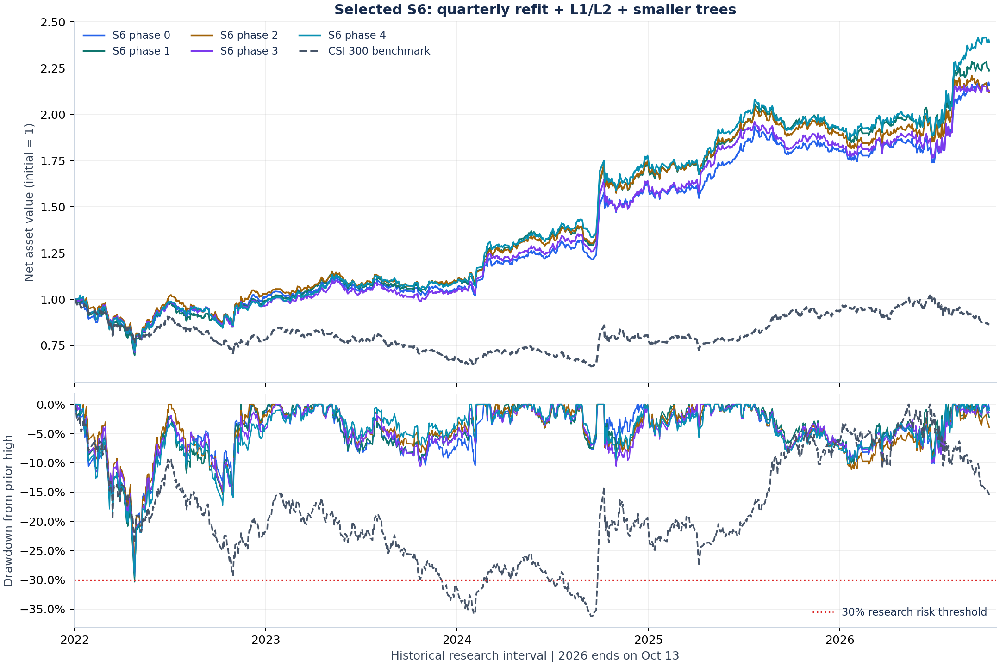
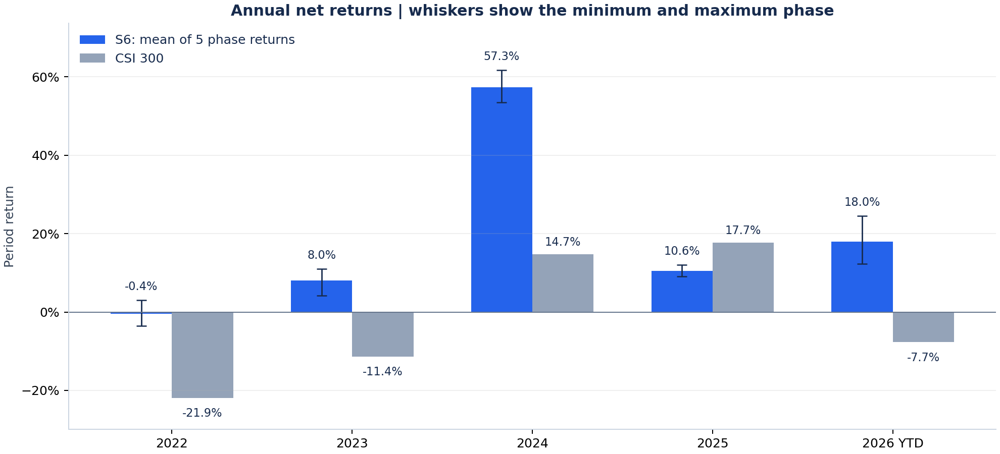

# S6季度联合约束策略研究报告

当前主版本为 `S6_head6_40_QREG`：原始15因子预测未来10日收益排名，季度从零训练，L1/L2增强并降低树复杂度；Top20前6只占股票仓位40%，每5个交易日调仓，最多替换6只。

2022-01-04至2026-10-13的连续研究账户，五个预设调仓起点的平均复合年化为18.85%，最差最大回撤为30.35%。原年度版本17.13%、原季度版本17.36%，属于另外两组训练设置。

采用固定年化无风险利率1%时，五起点平均年化夏普为1.000，相对沪深300的平均年化信息比率为1.503。该假设只改变夏普的机会成本基准，不改变账户收益或回撤。

完整报告已集中到[当前策略报告](../reports/current_strategy/README.md)，包括训练与标签边界、持仓规则、五起点指标、逐年收益、费用、来源哈希以及可复算的图表。





## 复算图表

安装仓库研究依赖后执行：

```powershell
python -m scripts.build_current_strategy_report
```

该命令使用仓库内的历史研究汇总，重新计算表格与图像，不下载行情、不重新训练、不连接券商。完整训练复现另需冻结快照及父实验，见[数据契约](data_contract.md)。

2022至2026已反复参与研究，不能称为新的独立测试。当前版本的30.35%最差回撤超过原30%历史筛选线；09:31后模拟限价执行也不保证按日线开盘价成交。指标解释见[研究结果与口径](results.md)。

旧年度Top50、旧标签与2022至2024结果已归入[历史研究报告](history/annual_top50_report.md)。
