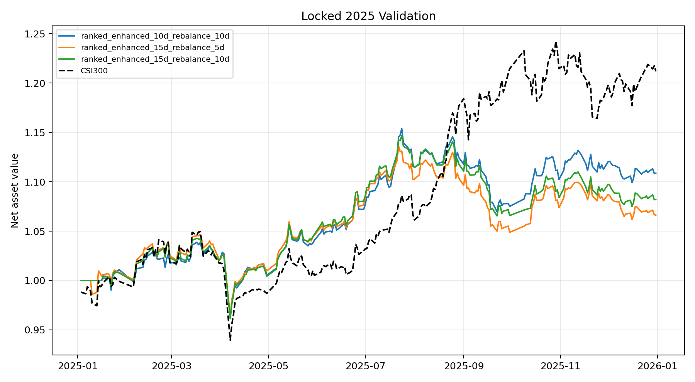

# 锁定的2025独立验证

本实验在查看2025策略结果前锁定了三个候选：10日预测/10日调仓、15日预测/5日调仓、15日预测/10日调仓。模型使用2013—2023训练、2024验证确定迭代轮数，随后用2013—2024重新拟合，只预测和回测2025年。

## 数据完整性

- Qlib日频行情和动态CSI300成分完整覆盖2025；
- 巨潮实际披露日期已补充至2025年财报，2025财务行披露日期匹配率98.36%；
- 基本面数据只在实际披露日后的下一自然日进入因子面板；
- 10日和15日标签均有2026行情支持，不会因年末截断。

## 2024验证集模型IC

| 模型 | Mean Rank IC | Rank IC为正比例 | 最佳迭代 |
|---|---:|---:|---:|
| 10日排名模型 | 9.37% | 69.40% | 221 |
| 15日排名模型 | 9.87% | 70.93% | 288 |

## 2025独立结果

| 候选 | 年化收益 | 沪深300年化 | 年化超额 | 夏普 | 信息比率 | 最大回撤 | 日均换手 |
|---|---:|---:|---:|---:|---:|---:|---:|
| **10日预测/10日调仓（主模型）** | **11.33%** | 22.16% | **-8.86%** | **1.014** | **-0.820** | **-7.36%** | 4.15% |
| 15日预测/5日调仓 | 6.90% | 22.16% | -12.49% | 0.643 | -1.229 | -7.94% | 7.03% |
| 15日预测/10日调仓 | 8.56% | 22.16% | -11.13% | 0.798 | -1.069 | -7.81% | 4.07% |

## 2025预测排序能力

| 模型 | Mean IC | Mean Rank IC | Rank IC为正比例 |
|---|---:|---:|---:|
| 10日排名模型 | -2.87% | 0.33% | 46.09% |
| 15日排名模型 | -4.68% | -1.46% | 42.39% |

三个组合都取得正绝对收益，但都跑输强势上涨的沪深300。10日/10日主模型在三个锁定候选中收益最高、回撤最低，支持此前关于相对稳健性的选择；不过其2025 Rank IC接近零且超额收益为负，说明2022—2024的强Alpha没有延续到2025。2025结果已经揭示，不能再用于继续调参后仍称为独立测试。

