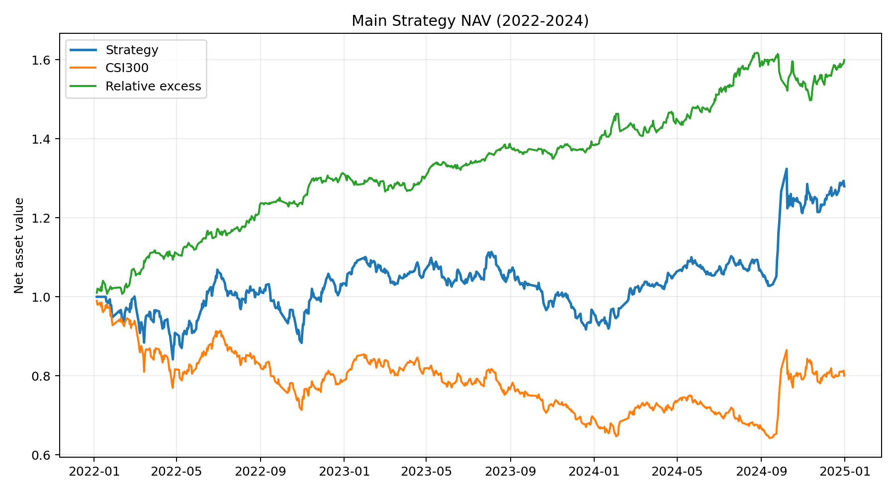
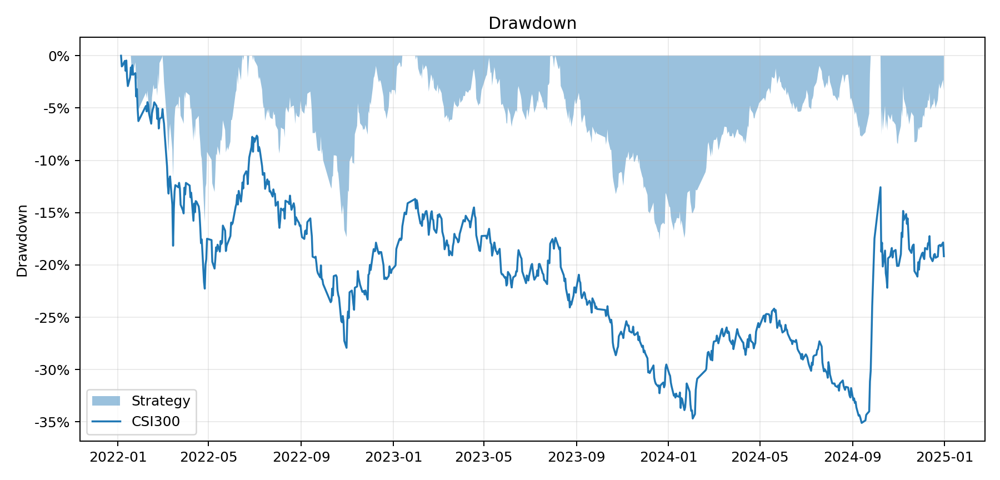
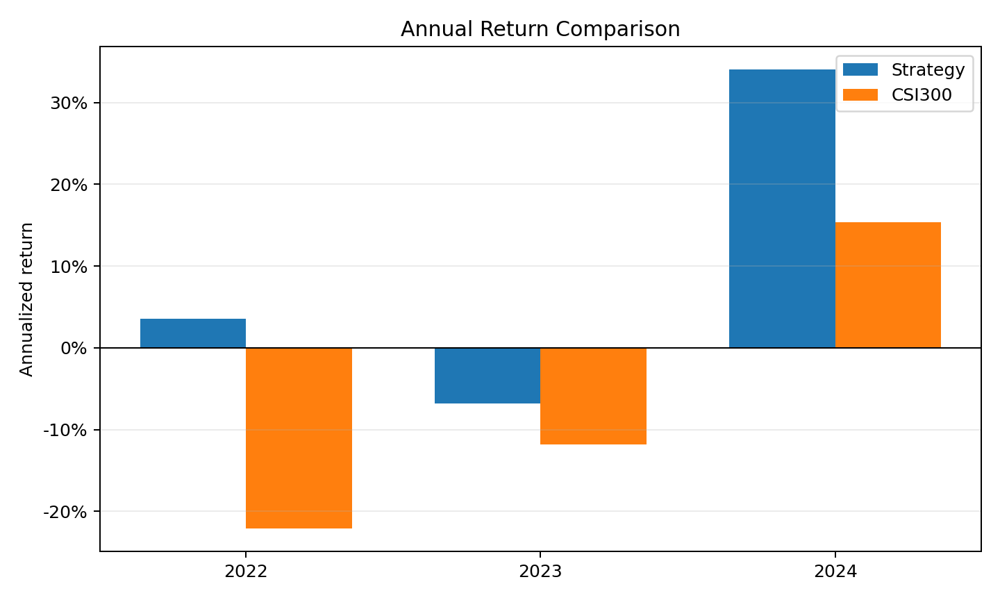

# 历史年度Top50策略结果

本目录保留旧年度Top50、开盘至收盘标签的研究结果。当前选定的S6季度联合约束策略见[当前报告](../current_strategy/README.md)，其图表和收益不使用本目录数据。

旧版本为扩展样本、年度滚动重训的 `ranked_enhanced` LightGBM，通过时间序列多折验证选择树数，预测未来10日横截面收益排名，每10个交易日调仓。下表已按本目录 `backtest_comparison.csv` 核对。

## 总体结果（2022—2024）

| 年化收益 | 年化超额 | 夏普 | 信息比率 | 最大回撤 | 日均换手 |
|---:|---:|---:|---:|---:|---:|
| 8.95% | 17.73% | 0.568 | 2.027 | -17.64% | 4.62% |

## 图表

## 文件

- `backtest_comparison.csv`：全区间指标；
- `backtest_yearly.csv`：分年度指标；
- `backtest_daily.csv`：每日账户净值、基准、超额、换手和成本。
- `test_ic_summary.csv`：各测试年度IC与Rank IC。

2022—2024已经用于研究方案比较，因此这里报告的是滚动样本外研究结果，而不是完全未触碰的最终测试结果。
