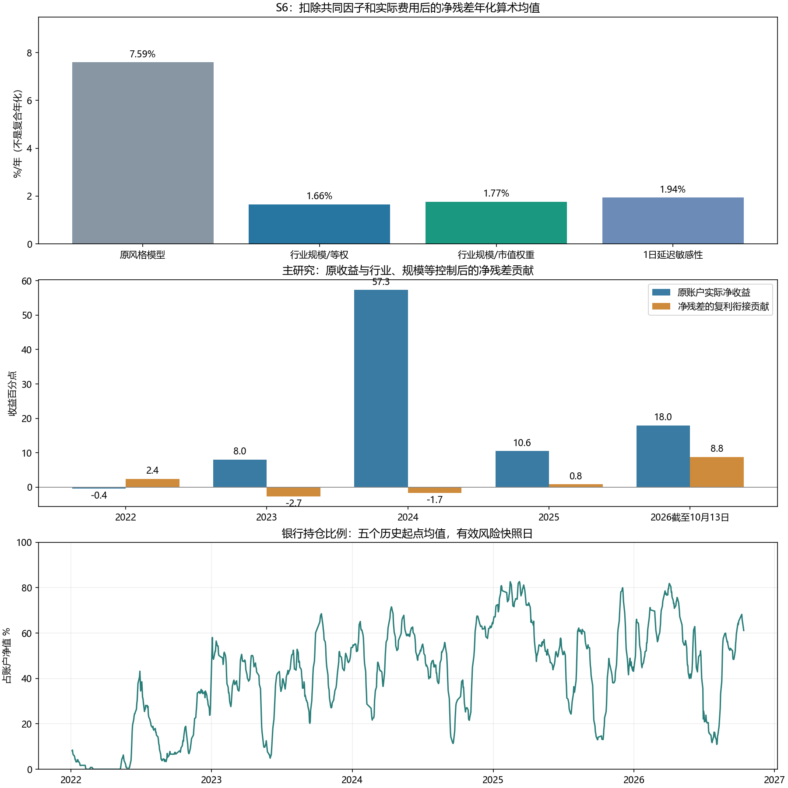

# 行业规模补齐后的风险诊断

研究对象是冻结Top20 S6五起点，截至2026-10-13，不是当前模拟持仓；自建模型不使用商业Barra数据。

行业／市值覆盖约98.71%／99.95%。净残差年化算术均值约1.77%，较不完整参照减少76.7%，主HAC区间均包含0。残差含个股残差、交易时点及费用，不是可投资对冲组合复合收益，不能称已证明Alpha。

[结论](findings.json) · [区间](residual_mean_hac.csv) · [逐年](residual_yearly.csv) · [银行暴露](bank_exposure_by_year.csv) · [证据](evidence.json) · [方法](../../../docs/barra_risk.md)
